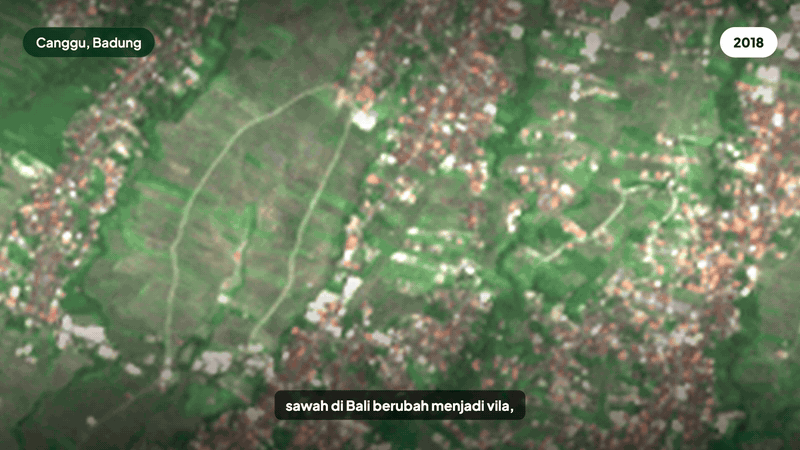

# JAGA SAWAH

Penulis: Hilmi (https://master-hilmi.vercel.app/)

**Coba sekarang: https://jaga-sawah.vercel.app** · Cara kami mengukur akurasi: https://jaga-sawah.vercel.app/validasi



*Cuplikan 18 detik: citra satelit Canggu 2018 ke 2025, peta kandidat Badung, detail kandidat, dan cek lokasi dengan AI.*

## Description

JAGA SAWAH memantau alih fungsi Lahan Sawah yang Dilindungi (LSD) di Bali dengan citra satelit dan AI. Aplikasi ini memadukan citra satelit Sentinel-1 dan Sentinel-2, embedding AlphaEarth, model deteksi perubahan, dan AI yang memeriksa serta menjelaskan setiap kandidat dalam bahasa Indonesia. Versi ini mencakup seluruh Kabupaten Badung (8.599 ha LSD), periode 2018 ke 2023, ditambah periode terbaru 2023 ke 2025.

## Problem & Target User

Sawah di Bali terus beralih menjadi vila, perumahan, dan jalan, termasuk di dalam LSD. Perpres 4/2026 menyatakan LSD yang belum masuk lahan pertanian pangan berkelanjutan tidak dapat dialihfungsikan sebelum ada rekomendasi menteri (Pasal 17 ayat 1). Perda Provinsi Bali 4/2026 melarang lahan produktif dalam rencana tata ruang dialihfungsikan (Pasal 13 ayat 2). Pengawasan masih bergantung pada laporan dan pengecekan manual, sehingga pelanggaran sering baru diketahui setelah bangunan berdiri. Menurut data bangunan tahunan Google (Open Buildings Temporal), sekitar 87 ha piksel LSD Badung menjadi bangunan antara 2018 dan 2023. Angka ini bergantung pada ambang keyakinan data itu (35 sampai 218 ha untuk ambang 0,5 sampai 0,1) dan hanya mencakup bangunan yang terdeteksi, belum tanah urug dan jalan.

Pengguna:

- Dinas Pertanian dan Pangan, Dinas PUPR, dan Satpol PP kabupaten: daftar kandidat yang siap ditinjau, dengan alasan dan dasar aturan.
- Subak dan Desa Adat, yang menurut Perda Bali 4/2026 Pasal 24 menjadi bagian tim pengawasan: melihat perubahan di wilayahnya dan melapor.
- Warga: mengecek status suatu lokasi dan melaporkan pembangunan di sawah.

## Key Features

- Peta seluruh LSD Badung dengan kandidat alih fungsi dalam empat status: terverifikasi AI, perlu tinjau petugas, belum diverifikasi, ditolak AI.
- Dua periode: 2018 ke 2023, dan periode terbaru 2023 ke 2025 (eksperimental).
- Detail kandidat: luas, periode, putusan AI dengan tingkat keyakinan, alasan dalam bahasa Indonesia, dan citra Sentinel-2 tahun 2018, 2023, 2025. Di ponsel, detail muncul sebagai lembar di atas peta.
- **Cek lokasi dengan AI**: klik titik mana pun, AI menjelaskan apakah titik itu di dalam LSD, kandidat di dekatnya, dan pasal yang relevan beserta syarat berlakunya.
- **Lapor dengan foto**: warga atau subak mengunggah foto lapangan, AI menyaringnya menjadi kategori dan prioritas. Metadata foto (lokasi GPS, kamera, waktu) dihapus di server sebelum dikirim ke AI, dan foto tidak disimpan.
- Halaman **Validasi**: angka, cara ukur, pengaruh ambang data pembanding, pembanding lain, studi kasus dari berita, dan batasan.
- Tautan yang bisa dibagikan: `?patch=<id>` membuka satu kandidat, `?lat=&lon=&z=` membuka posisi peta tertentu.
- Batas pemakaian AI per perangkat dan per hari.

## Tech Stack

- Frontend: Next.js 16 (App Router), React 19, Tailwind CSS 4, MapLibre GL JS 6 lewat react-map-gl 8, basemap OpenFreeMap.
- Backend: Next.js Route Handlers di Vercel (`/api/cek-lokasi`, `/api/lapor`). Data hasil pipeline disimpan sebagai GeoJSON dan PNG statis; poligon LSD hanya di server.
- Pipeline data (offline, Python): Google Earth Engine (batch), Microsoft Planetary Computer STAC, `odc-stac`, `xarray`, `scikit-learn`, `geopandas`, DuckDB.
- AI: embedding AlphaEarth Foundations dan random forest (scikit-learn) untuk deteksi; Claude (`claude-opus-5-5`, Anthropic API) untuk verifikasi batch, cek lokasi, dan penyaringan laporan foto.

## AI Implementation

| Lapis | Metode | Input | Output |
|---|---|---|---|
| Representasi | Google Satellite Embedding V1 (AlphaEarth Foundations) | Citra multisensor tahunan | Vektor 64 dimensi per piksel 10 m |
| Deteksi | Random forest pada 241 fitur dua waktu | Sentinel-2 (6 band, NDVI median, sebaran, persentil 90, NDBI, MNDWI, BSI), Sentinel-1 (VV, VH, sebaran VV, rasio), embedding AlphaEarth, untuk dua tahun dan selisihnya | Probabilitas alih fungsi per piksel, lalu petak kandidat |
| Verifikasi | Model bahasa besar multimodal, output JSON terstruktur | Satu gambar tiga tahun dan nilai indeks per kandidat | Verdict dari enum tetap (`conversion`, `already_built`, `harvest_or_fallow`, `flooding`, `cloud_artifact`, `unclear`), keyakinan, alasan |
| Cek lokasi | Model yang sama, langsung | Fakta titik dari server (LSD atau bukan, kandidat di dekatnya) | Penjelasan, saran, dan pasal yang dipilih dari daftar tetap |
| Lapor | Model yang sama, vision, langsung | Foto, catatan, fakta lokasi | Kategori, tanda yang terlihat, keyakinan, prioritas |

Label latih berasal dari Google Open Buildings 2.5D Temporal (keberadaan bangunan per tahun), diambil lewat Earth Engine dalam skrip batch. AI hanya boleh memilih pasal dari daftar yang dikutip dari teks resmi Perpres 4/2026 (peraturan.bpk.go.id) dan Perda Provinsi Bali 4/2026 (JDIH Provinsi Bali), dan setiap pasal bersyarat ditampilkan bersama syaratnya. Penjelasan dan saran tetap teks bebas. AI verifikasi tidak pernah melihat label referensi. Hanya kandidat seluas minimal 1.000 m² yang diverifikasi AI.

## Pengujian

Pembanding semua uji adalah Google Open Buildings 2.5D Temporal (OBT), data bangunan tahunan yang dibuat Google dari citra Sentinel-2 dengan model lain. OBT juga menjadi label latih. Karena sumber citranya sama, angka di bawah mengukur **kecocokan dengan OBT, bukan akurasi terhadap kondisi lapangan**, dan bergantung pada ambang yang dipakai untuk menyebut piksel OBT sebagai bangunan (keyakinan di bawah 0,1 pada 2018 dan minimal 0,3 pada 2023). Skrip dan file hasil tiap uji ada di [`pipeline/`](pipeline/README.md). Kecuali disebut lain, penilaian dilakukan di **semua piksel LSD dengan prevalensi asli**, bukan hanya contoh yang mudah. Ambang keputusan selalu dipilih dari data latih.

### 1. Model deteksi

| Uji | Wilayah dan cara | Pembanding | Hasil |
|---|---|---|---|
| A. Label dari peta tutupan lahan global (IO LULC 10 m) | Kuta Utara, CV blok 1 km | IO LULC | Akurasi 55,8%. Peta global ini menyebut 559 dari 799 ha LSD sudah bangunan pada 2023, padahal citra masih menunjukkan sawah. **Ditolak sebagai sumber label.** |
| B. Model v1, dilatih di piksel jelas (footprint Overture) | Kuta Utara | Open Buildings Temporal, seluruh LSD | Presisi 0,10, recall 0,91. Terlalu banyak menandai piksel campuran. **Angka v1 ditarik.** |
| C. Model v2: Sentinel-1 + Sentinel-2, label Open Buildings Temporal di semua piksel | Kuta Utara, CV blok 1 km, prevalensi 4,7% | Open Buildings Temporal | Presisi 0,51, recall 0,75, average precision 0,57 |
| D. Model v3: ditambah AlphaEarth | Kuta Utara, cara sama | Open Buildings Temporal | **Presisi 0,58, recall 0,73, average precision 0,65** |
| E. AlphaEarth saja | Kuta Utara, cara sama | Open Buildings Temporal | Presisi 0,53, recall 0,69, average precision 0,58 |
| F. **Model v3 untuk seluruh Badung** | 27 tile 5 km, CV dengan tile utuh (setiap wilayah dinilai model yang belum pernah melihatnya), 848.840 piksel LSD, prevalensi 1,0% | Open Buildings Temporal | **Presisi 0,56 (selang 95% antar-tile 0,52 sampai 0,58), recall 0,60 (0,47 sampai 0,67), average precision 0,57**. Pada ambang probabilitas 0,9: presisi 0,65, recall 0,42 |

Hasil per kelompok tile pada uji F:

| Kelompok | Tile | Prevalensi | Presisi | Recall |
|---|---|---|---|---|
| 1 | 6 | 1,24% | 0,58 | 0,52 |
| 2 | 6 | 0,89% | 0,54 | 0,57 |
| 3 | 5 | 0,29% | 0,30 | 0,55 |
| 4 | 5 | 0,38% | 0,58 | 0,59 |
| 5 | 5 | 2,83% | 0,58 | 0,71 |

Kelompok 3 hampir tanpa perubahan (prevalensi 0,29%), sehingga sedikit alarm palsu langsung menurunkan presisi. Secara umum, 19 tile dengan prevalensi di bawah 0,5% mencakup 71% LSD, dan di sana presisinya 0,50 dan recall-nya 0,49.

Selang 95% berasal dari bootstrap 1.000 kali atas 27 tile. Tidak ada tanda kebocoran di tepi tile: piksel uji dalam 250 m dari tile latih memberi presisi 0,555, dan yang lebih dari 1 km memberi 0,547. Peta di aplikasi dibuat oleh model yang dilatih di semua tile, jadi angka validasi silang ini berlaku untuk wilayah yang belum pernah dilihat model.

**Pengaruh ambang OBT** (prediksi model tetap, hanya ambang keyakinan OBT 2023 yang diubah; file `pipeline/results/qt02_cv_extra.json`):

| Ambang OBT 2023 | Bangunan baru di LSD Badung | Presisi | Recall |
|---|---|---|---|
| 0,1 | 218 ha | 0,86 | 0,37 |
| 0,2 | 133 ha | 0,71 | 0,50 |
| **0,3 (dipakai)** | **87 ha** | **0,56** | **0,60** |
| 0,4 | 57 ha | 0,41 | 0,67 |
| 0,5 | 35 ha | 0,27 | 0,73 |

**Per petak** (`pipeline/results/qt02_patch_level.json`): dari 849 petak kandidat hasil validasi silang, 90% menyentuh paling sedikit satu piksel bangunan baru menurut OBT, dan 66% sebagian besar berisi bangunan baru. Sebagian besar piksel yang tidak cocok (76%) berada di petak yang juga berisi bangunan baru menurut OBT.

**Diagnosis alarm "palsu"** (Kuta Utara, v2). Piksel yang ditandai model tetapi tidak tercatat sebagai bangunan oleh Open Buildings Temporal kehilangan vegetasi seperti alih fungsi yang benar: NDVI 0,68 ke 0,19, sedangkan sawah stabil 0,69 ke 0,75. Sebanyak 68% di antaranya sudah punya sebagian bangunan. Sebagian alarm itu mungkin tanah urug atau bangunan yang belum selesai, tetapi hal ini belum diukur.

### 2. AI verifikasi

| Uji | Kandidat | Hasil |
|---|---|---|
| Kandidat v1, Kuta Utara (**ditarik**, dinilai hanya pada piksel jelas) | 77 | Presisi naik dari 0,75 ke 0,92 pada piksel jelas; 16 dari 19 alarm palsu ditolak |
| Kandidat v2 dan v3, Kuta Utara | 160 dan 142 | Presisi tidak berubah (0,55 ke 0,55; 0,63 ke 0,64). Setelah model membaik, hampir tidak ada lagi alarm palsu yang bisa disaring dari citra 10 m |
| Seluruh Badung | 315 dari 997 (kandidat minimal 1.000 m²) | 195 alih fungsi, 87 perlu tinjau, 26 sudah bangunan sejak 2018, 6 panen atau bera, 1 awan. Biaya sekitar US$1,29 per putaran, dihitung dari jumlah token |

Kesimpulannya, AI verifikasi **tidak dipakai untuk mengklaim kenaikan akurasi**. Perannya menjelaskan setiap kandidat dan memilah mana yang perlu dicek petugas. Untuk 26 petak yang diberi putusan sudah bangunan sejak 2018, data OBT tidak mendukung putusan itu pada hampir semua petak (median keyakinan OBT 2018 di petak itu 0,04), jadi petak tersebut perlu dicek petugas sebelum dianggap kesalahan peta LSD.

### 3. Studi kasus dari berita

Dicocokkan di tingkat desa, karena berita tidak memuat koordinat bangunan.

| Desa, kasus | Kandidat 2018 ke 2023 | Dibanding rata-rata Badung (1,06% LSD) |
|---|---|---|
| Canggu: kurang lebih 30 vila di Babakan Canggu dihentikan akhir Desember 2025 karena berdiri di LSD dan LP2B (Bali Post, 2 Januari 2026) | 100 petak, 6,8% LSD, 25 terverifikasi | 6,4 kali |
| Munggu: sedikitnya tujuh bangunan yang diduga berdiri di LSD Subak Munggu, pemiliknya dipanggil Satpol PP (Bali Post, 6 September 2026) | 85 petak, 2,0% LSD, 18 terverifikasi | 1,9 kali |

Keduanya juga tetap menonjol pada periode 2023 ke 2025: Canggu 4,9 kali dan Munggu 2,3 kali rata-rata.

### 4. Kualitas data

- Citra Sentinel-2 musim kemarau 2018 tidak punya pengamatan bebas awan untuk 1,8% LSD, terpusat di Munggu. Piksel itu sempat terlewat tanpa peringatan. Celahnya diisi dengan komposit Januari 2018 sampai Juni 2019, dan seluruh uji F dijalankan ulang.

### 5. Tinjauan manusia buta

41 titik, diacak, dengan kontrol positif dan negatif yang tidak diketahui peninjau. Kecocokan dengan kontrol hanya 10 dari 20, setara tebakan. Pada citra 10 m, mata cenderung menilai bangunan di sekitar kotak, bukan isi kotaknya. **Hasil ini tidak dipakai sebagai bukti akurasi.** Pelajarannya, verifikasi visual membutuhkan citra resolusi tinggi.

### 6. Aplikasi

- `npm run lint` dan `npm run build` lulus.
- Diuji di browser headless pada situs produksi, dengan viewport desktop dan emulasi ponsel: 0 error console, 0 permintaan gagal.
- Cek lokasi dan lapor diuji langsung di produksi. Cek lokasi menjawab dalam sekitar 7 detik.
- Poligon LSD tidak bisa diunduh dari URL publik (HTTP 404); server tetap memakainya untuk cek lokasi.

## Architecture / Data Flow

```
[Pipeline offline]
Earth Engine: Sentinel-1, Sentinel-2, AlphaEarth, Open Buildings Temporal
  -> fitur per tile 5 km -> random forest -> petak kandidat di dalam LSD
  -> AI verifikasi (batch) -> GeoJSON + chip PNG

[Aplikasi web, Vercel]
Browser (Next.js, MapLibre) -> peta, detail, validasi (file statis)
Browser -> /api/cek-lokasi -> LSD di server -> AI -> penjelasan + pasal
Browser -> /api/lapor (foto) -> AI (vision) -> kategori + prioritas
```

Earth Engine hanya dipakai di pipeline offline, jadi aplikasi tidak bergantung pada layanan citra saat dibuka. Kunci API disimpan sebagai environment variable di server dan tidak pernah dikirim ke browser.

## Installation / Run Instructions

```
npm install
npm run dev
```

Data hasil pipeline ada di `public/data/` dan `data/`, dan tidak di-commit karena ketentuan redistribusi peta LSD dari BIG belum jelas. Skrip pipeline yang menghasilkannya, beserta ringkasan metrik semua uji, ada di [`pipeline/`](pipeline/README.md). Salin `.env.example` ke `.env.local` dan isi `ANTHROPIC_API_KEY` untuk mengaktifkan cek lokasi dan lapor; batas pemakaian diatur dengan `AI_DAILY_LIMIT` dan `AI_PER_IP_LIMIT`.

## Deployment URL

https://jaga-sawah.vercel.app

## Demo Account

Tidak diperlukan.

## Known Limitations

- Resolusi 10 m: bangunan kecil dan piksel campuran di tepi permukiman sering diberi status "perlu tinjau".
- Angka akurasi adalah kecocokan dengan OBT, yang juga dibuat dari Sentinel-2. Akurasi terhadap kondisi lapangan belum diukur; langkah berikutnya adalah sampel acuan berstrata dari citra resolusi tinggi berlisensi atau cek lapangan Dinas.
- Pembanding akurasi hanya mencatat bangunan sampai 2023. Tanah urug, jalan, dan bangunan 2024 sampai 2025 tidak terhitung, dan periode 2023 ke 2025 belum punya angka akurasi.
- Petak yang memotong batas tile 5 km terbelah dua; tahun bangunan muncul baru tersedia untuk Kuta Utara.
- Peta LSD BIG (metadata 2021) memuat sebagian rumah yang sudah ada sebelumnya.
- Aplikasi belum memuat peta LP2B dan rencana tata ruang, jadi syarat Perpres 4/2026 Pasal 17 ayat (1) dan Perda Bali 4/2026 Pasal 13 ayat (2) belum bisa ditentukan per titik.
- Hasil adalah indikasi, bukan putusan hukum. Setiap kandidat wajib ditinjau petugas.

## Third-party Resources / Credits

- Contains modified Copernicus Sentinel data (2018 to 2025), lewat Google Earth Engine dan Microsoft Planetary Computer.
- Embedding citra: Google Satellite Embedding V1 (AlphaEarth Foundations), lewat Google Earth Engine (nonkomersial).
- Bangunan per tahun: Google Open Buildings 2.5D Temporal (CC BY 4.0).
- Masker awan: Cloud Score+ (Google). Uji awal: IO LULC annual v02 (Impact Observatory, Microsoft, dan Esri; CC BY 4.0).
- Peta Lahan Sawah yang Dilindungi: BIG Satu Peta, layer 59.
- Teks regulasi: Perpres 4/2026 (peraturan.bpk.go.id) dan Perda Provinsi Bali 4/2026 (JDIH Provinsi Bali).
- Footprint bangunan untuk uji awal: Overture Maps Foundation (ODbL), berisi Google Open Buildings (CC BY 4.0), Microsoft Building Footprints (ODbL), dan OpenStreetMap (ODbL).
- Basemap: OpenFreeMap, OpenMapTiles, data OpenStreetMap. Batas wilayah: OpenStreetMap lewat Nominatim.
- Disclosure lengkap: [docs/ai-technology-disclosure.md](docs/ai-technology-disclosure.md).

## Team Members

- Hilmi (https://master-hilmi.vercel.app/)
