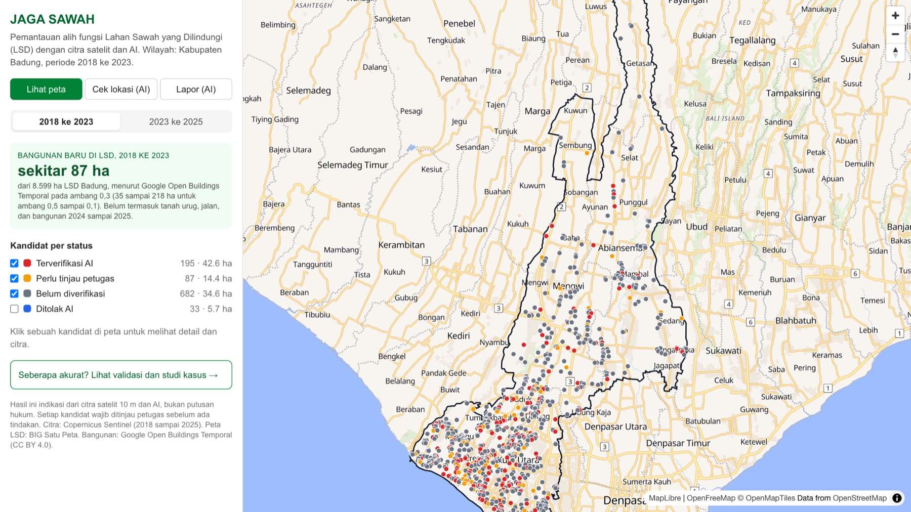
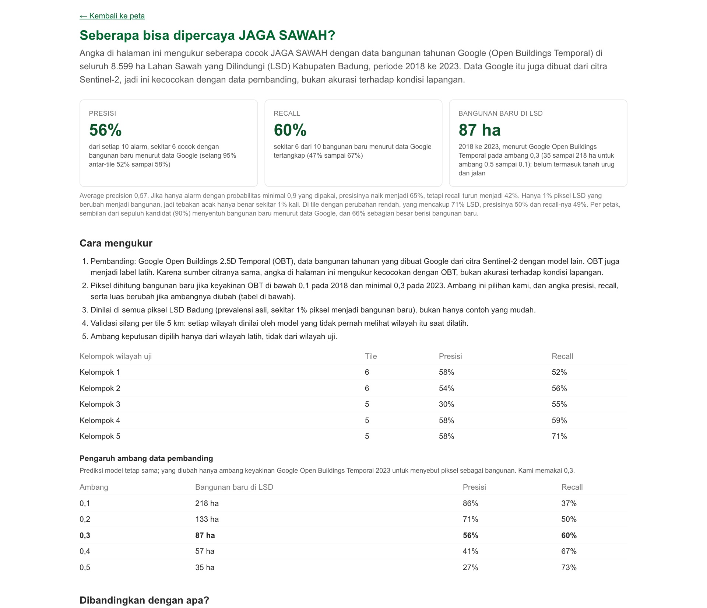

# JAGA SAWAH

**Pemantauan Alih Fungsi Lahan Sawah yang Dilindungi dengan Citra Satelit dan AI**

AI Web Innovation Challenge, Bali DigiFest 2026, Kategori Mahasiswa/Umum

| Sampul | |
|---|---|
| Nama produk | JAGA SAWAH |
| Nama tim | Manifold Datafolk |
| Ketua dan anggota | Hilmi (ketua tim dan satu-satunya anggota) |
| Instansi | Black Sand Distribution |
| Kontak ketua tim | https://master-hilmi.vercel.app/ |
| URL MVP | https://jaga-sawah.vercel.app |
| Repositori | https://github.com/masterA88/jaga-sawah |

---

## 1. Masalah dan Latar Belakang (*Problem & Background*)

Sawah di Bali terus beralih fungsi menjadi vila, perumahan, dan jalan, termasuk sawah yang berstatus Lahan Sawah yang Dilindungi (LSD). Pasal 17 ayat (1) Perpres 4/2026 menyatakan bahwa LSD yang belum masuk penetapan lahan pertanian pangan berkelanjutan "tidak dapat" dialihfungsikan sebelum ada rekomendasi menteri. Perda Provinsi Bali 4/2026 lebih tegas: lahan produktif dalam rencana tata ruang "dilarang dialihfungsikan" (Pasal 13 ayat (2)). Pelanggarnya dikenai sanksi sampai pembongkaran bangunan (Pasal 20 ayat (2)).

Aturannya sudah ada, tetapi pengawasannya tertinggal. Perda Bali 4/2026 mewajibkan pengawasan paling sedikit satu kali dalam enam bulan (Pasal 18 ayat (1)). Dalam praktiknya, pelanggaran biasanya baru diketahui setelah bangunan berdiri, melalui laporan warga atau pemberitaan. Pada September 2026, misalnya, Satpol PP Badung memanggil pemilik sedikitnya tujuh bangunan yang diduga berdiri di LSD Subak Munggu. Pada akhir Desember 2025, kurang lebih 30 vila di Babakan, Canggu, disegel oleh Pansus TRAP DPRD Bali.

Menurut data bangunan tahunan Google Open Buildings 2.5D Temporal (OBT), sekitar 87 ha piksel LSD di Badung berubah menjadi bangunan antara 2018 dan 2023. Angka ini bergantung pada ambang keyakinan yang dipakai pada data tersebut (35 sampai 218 ha untuk ambang 0,5 sampai 0,1) dan hanya mencakup bangunan yang terdeteksi. Tanah urug dan jalan belum terhitung. Dengan demikian, angka ini menggambarkan alih fungsi berupa bangunan di dalam LSD, belum seluruh alih fungsi sawah di Badung. Di Kuta Utara, menurut data yang sama, luas bangunan baru di LSD naik setiap tahun, dari 2,4 ha pada 2019 menjadi 19,7 ha pada 2023.

## 2. Pengguna Sasaran (*Target User*)

| Pengguna | Kebutuhan | Kesulitan saat ini |
|---|---|---|
| Dinas Pertanian dan Pangan, Dinas PUPR, dan Satpol PP Kabupaten Badung | Daftar lokasi yang perlu diperiksa, lengkap dengan bukti dan dasar hukumnya | Wilayahnya luas, petugasnya terbatas, pemeriksaan dilakukan manual, dan informasi datang terlambat |
| Subak dan Desa Adat (bagian tim pengawasan menurut Pasal 24 Perda Bali 4/2026) | Mengetahui apakah sawah di wilayahnya termasuk LSD dan apakah ada yang berubah; cara melapor | Tidak memiliki akses ke peta LSD dan citra satelit; tidak tahu harus melapor ke mana |
| Warga | Mengecek status suatu lokasi sebelum membeli atau menyewa lahan; melaporkan pembangunan di sawah | Status LSD sulit dicari, dan laporan warga tidak terstruktur |

## 3. Solusi yang Diusulkan (*Proposed Solution*)

JAGA SAWAH adalah peta web yang menunjukkan petak LSD yang kemungkinan sudah beralih fungsi, lengkap dengan penjelasan dan dasar hukumnya. Pasal 19 Permen ATR/BPN 2/2024 sudah mengatur pemantauan LSD melalui tumpang susun peta dan interpretasi citra satelit. JAGA SAWAH mengotomatiskan tahap interpretasi citra itu untuk seluruh LSD Badung, lalu menyerahkan hasilnya kepada petugas untuk diperiksa.

Alur utama pengguna:

1. Petugas membuka peta Badung. Kandidat alih fungsi tampil dengan empat status: terverifikasi AI, perlu ditinjau petugas, belum diverifikasi, dan ditolak AI. Petugas dapat memilih periode 2018 sampai 2023 atau periode terbaru 2023 sampai 2025 (eksperimental).
2. Petugas mengeklik sebuah kandidat. Panel menampilkan luas petak, putusan AI beserta tingkat keyakinannya, alasan dalam bahasa Indonesia, serta citra Sentinel-2 tahun 2018, 2023, dan 2025.
3. Siapa pun dapat memakai mode **Cek lokasi**. Pengguna mengeklik titik mana pun, lalu AI menjelaskan apakah titik itu berada di dalam LSD, apakah ada kandidat di dekatnya, pasal yang relevan beserta syaratnya, dan langkah berikutnya.
4. Warga atau subak memakai mode **Lapor**. Pengguna memilih lokasi dan mengunggah foto lapangan, lalu AI memilah laporan itu menurut kategori dan prioritas.
5. Halaman **Validasi** menjelaskan cara kami mengukur hasil, angka yang diperoleh, dan batasannya.

## 4. Implementasi AI (*AI Implementation*)

JAGA SAWAH memakai AI dalam tiga lapisan. AI diperlukan karena perubahan petak seluas beberapa ratus meter persegi di ribuan hektare sawah tidak mungkin dipantau secara manual. Selain itu, citra satelit beresolusi 10 m sulit dibaca oleh orang awam.

| Lapisan | Metode | Masukan | Keluaran |
|---|---|---|---|
| Representasi | Google Satellite Embedding V1 (AlphaEarth Foundations) | Citra multisensor tahunan | Vektor 64 dimensi untuk setiap piksel 10 m, tahun 2018, 2023, dan 2025 |
| Deteksi | *Random forest* dengan 241 fitur dari dua waktu | Sentinel-2 (6 kanal serta indeks NDVI, NDBI, MNDWI, dan BSI), Sentinel-1 (VV dan VH), serta *embedding* AlphaEarth, untuk dua tahun beserta selisihnya | Probabilitas alih fungsi per piksel, yang kemudian dikelompokkan menjadi petak kandidat |
| Verifikasi dan penjelasan | Model bahasa besar multimodal melalui API dengan keluaran JSON terstruktur (model dan penyedianya disebutkan di bagian 9) | Potongan citra tiga tahun dan nilai indeks; fakta lokasi; foto dari warga | Putusan dari daftar nilai tetap (`conversion`, `already_built`, `harvest_or_fallow`, `flooding`, `cloud_artifact`, `unclear`), alasan, prioritas, dan pasal dari daftar tetap |

Model deteksi dilatih dengan label dari OBT, yaitu data keberadaan bangunan per tahun. Kandidat dengan luas minimal 1.000 m² (315 dari 997 kandidat) diverifikasi AI secara *batch* dengan biaya sekitar US$1,3 per putaran menurut hitungan token. Kandidat yang lebih kecil tetap ditampilkan dengan status belum diverifikasi. Fitur Cek lokasi dan Lapor memanggil model yang sama secara langsung. AI hanya boleh memilih pasal dari daftar yang dikutip dari teks resmi Perpres 4/2026 dan Perda Bali 4/2026, dan setiap pasal bersyarat ditampilkan bersama syaratnya. Penjelasan dan saran dari AI tetap berupa teks bebas sehingga harus dibaca sebagai indikasi.

**Akurasi dan maknanya.** Pembandingnya adalah OBT, data bangunan tahunan yang dibuat Google dari citra Sentinel-2 dengan model lain. Model kami diuji pada *tile* 5 km yang tidak dipakai dalam pelatihan dan pada semua piksel LSD Badung, padahal hanya sekitar 1% piksel yang berubah. Kecocokannya dengan data tersebut adalah **presisi 0,56** (selang 95% antar-*tile* 0,52 sampai 0,58) dan ***recall* 0,60** (0,47 sampai 0,67). Angka ini mengukur kecocokan dengan data Google, bukan akurasi terhadap kondisi lapangan, dan bergantung pada ambang yang dipakai untuk menyatakan piksel OBT sebagai bangunan. Pada *tile* dengan perubahan rendah, yang mencakup 71% LSD, presisinya 0,50 dan *recall*-nya 0,49. Pada tingkat petak, sembilan dari sepuluh kandidat bersinggungan dengan bangunan baru menurut data Google, dan dua dari tiga kandidat sebagian besar berisi bangunan baru. Jika hanya alarm dengan probabilitas minimal 0,9 yang dipakai, presisi naik menjadi 0,65, tetapi *recall* turun menjadi 0,42. Pada uji di Kuta Utara, *foundation model* AlphaEarth menaikkan *average precision* dari 0,57 menjadi 0,65.

AI verifikasi tidak menaikkan presisi deteksi, dan kami tidak mengklaimnya. Nilai tambahnya ada pada penjelasan untuk setiap kandidat dan pada pemilahan laporan warga. AI verifikasi memberi putusan "sudah berupa bangunan sejak 2018" kepada 26 petak. Data Google tidak mendukung putusan itu untuk hampir semua petak tersebut sehingga petak-petak itu perlu diperiksa petugas sebelum dianggap sebagai kesalahan peta LSD.

## 5. MVP dan Fitur Utama (*MVP & Key Features*)

Semua fitur berikut sudah berfungsi di URL MVP.

Fitur inti:

- Peta seluruh LSD Badung dengan 997 kandidat untuk periode 2018 sampai 2023, dilengkapi penyaring status dan pemilih periode.
- Panel detail kandidat yang memuat putusan dan alasan AI serta citra tiga tahun.
- Cek lokasi dengan AI, termasuk dasar hukum dan syarat berlakunya.
- Lapor dengan foto, yang dipilah AI menurut kategori dan prioritas. Metadata foto (lokasi GPS, kamera, dan waktu) dihapus di server sebelum foto dikirim ke AI, dan foto tidak disimpan.

Fitur pendukung:

- Periode 2023 sampai 2025 dengan 652 kandidat, ditandai eksperimental. Periode ini belum memiliki data pembanding sehingga belum ada angka akurasinya, dan kandidatnya belum diverifikasi AI.
- Halaman Validasi yang memuat angka, cara pengukuran, pengaruh ambang data pembanding, pembanding lain, dua studi kasus dari pemberitaan, dan batasan.
- Batas pemakaian AI per hari, untuk seluruh pengguna dan per alamat IP, agar kuota cukup selama masa penjurian.

## 6. Arsitektur Teknis (*Technical Architecture*)

```
Pengguna -> Frontend (Next.js + MapLibre di peramban)
         -> Backend (route handler Next.js di Vercel: /api/cek-lokasi, /api/lapor)
         -> Data (GeoJSON + PNG statis; poligon LSD hanya di server; tanpa basis data)
         -> AI/API (Claude melalui Anthropic API, keluaran JSON terstruktur)
         -> Hasil (putusan, alasan, pasal beserta syaratnya, kategori laporan)

Pipeline luring, dijalankan per periode, menghasilkan Data di atas:
Earth Engine (Sentinel-1, Sentinel-2, AlphaEarth, Open Buildings)
  -> fitur per tile 5 km -> random forest -> petak kandidat
  -> verifikasi AI (batch) -> GeoJSON + potongan citra PNG
```

Foto laporan melewati penghapusan metadata di *backend* sebelum dikirim ke AI. Earth Engine hanya dipakai pada *pipeline* luring. Aplikasi membaca berkas hasil sehingga tidak bergantung pada layanan citra ketika juri membuka aplikasi. Kunci API disimpan sebagai variabel lingkungan di server dan tidak pernah dikirim ke peramban. *Pipeline* sudah dijalankan satu kali untuk setiap periode. Penjadwalan rutin belum tersedia.

## 7. Inovasi dan Pembeda (*Innovation & Differentiation*)

| Pembanding | Yang dilakukan | Pembeda JAGA SAWAH |
|---|---|---|
| Pengawasan manual oleh Dinas dan Satpol PP | Bergantung pada laporan dan patroli | Daftar kandidat dari seluruh LSD kabupaten sekaligus, berdasarkan citra satelit |
| IDMAI (Bappenas, 2025) | Pemantauan sawah tingkat nasional. Modul alih fungsinya mengukur perubahan terhadap lahan baku sawah (LBS) selama minimal tiga tahun, dan akurasinya tidak dilaporkan | Bekerja di dalam poligon LSD kabupaten; alasan AI untuk setiap kandidat; pasal dari Perpres 4/2026 dan Perda Bali 4/2026; laporan warga; validasi terbuka |
| MapBiomas Indonesia | Peta tutupan lahan tahunan berbasis Landsat dengan kelas sawah dan peta transisi | Resolusi 10 m, di dalam poligon LSD, dengan kandidat per petak dan penjelasannya |
| Peta tutupan lahan global (misalnya IO LULC 10 m) | Kelas tutupan lahan tahunan | Pada uji di Kuta Utara, peta ini menyatakan 70% LSD sudah berupa bangunan pada 2023 sehingga tidak dapat dipakai sebagai label |

Sejauh penelusuran kami, belum ada pemenang lomba yang menggabungkan deteksi perubahan dari citra satelit, model bahasa besar untuk verifikasi dan penjelasan, serta peta web dalam satu produk untuk pengawasan sawah.

## 8. Dampak dan Potensi Pengembangan (*Impact & Development Potential*)

**Dampak.** Satu putaran pemindaian untuk seluruh Badung membutuhkan sekitar 30 menit komputasi fitur di Earth Engine, ditambah verifikasi AI secara *batch* yang biasanya selesai dalam satu jam, dengan biaya AI sekitar US$1,3 menurut hitungan token. Karena seluruh LSD Badung dipindai sekaligus, Pemda tidak perlu menunggu laporan warga atau berita untuk mengetahui lokasi yang perlu diperiksa. Subak dan Desa Adat, yang menurut Perda Bali 4/2026 menjadi bagian tim pengawasan, mendapat alat untuk menjalankan peran tersebut.

**Pengembangan.**

- Tumpang susun peta LP2B dan rencana tata ruang, sebagaimana diatur dalam Pasal 19 Permen ATR/BPN 2/2024, agar syarat Pasal 17 ayat (1) Perpres 4/2026 dan Pasal 13 ayat (2) Perda Bali 4/2026 dapat ditentukan untuk setiap titik.
- Sampel acuan berstrata (600 sampai 2.000 piksel) dari citra resolusi tinggi berlisensi atau dari pengecekan lapangan oleh Dinas agar luas dan akurasi terhadap kondisi lapangan dapat dihitung beserta selangnya.
- Perluasan ke kabupaten lain di Bali dengan *pipeline* yang sama, serta pembaruan terjadwal setiap kali citra baru tersedia.
- Basis data laporan warga dengan alur tindak lanjut petugas. Konfirmasi petugas dipakai sebagai label baru untuk melatih ulang model.

**Keterbatasan MVP.**

- Angka akurasi adalah kecocokan dengan data Google yang juga dibuat dari Sentinel-2. Akurasi terhadap kondisi lapangan belum diukur.
- Pada resolusi 10 m, bangunan kecil dan tepi permukiman sulit dinilai. Bangunan tunggal yang lebih kecil dari sekitar 150 sampai 300 m² kemungkinan besar terlewat (perkiraan dari aturan label, belum diukur).
- Model hanya menandai perubahan yang sudah menjadi bangunan menurut data pembanding. Tanah urug dan jalan belum terukur.
- Angka validasi silang mengukur kinerja pada wilayah yang belum pernah dilihat model, sedangkan peta di aplikasi dibuat oleh model yang dilatih dengan semua *tile* Badung.
- Periode 2023 sampai 2025 belum memiliki angka akurasi.
- Studi kasus dicocokkan pada tingkat desa karena pemberitaan tidak memuat koordinat.
- Hasil JAGA SAWAH adalah indikasi, bukan putusan hukum.

## 9. Pengungkapan Teknologi (*Technology Disclosure*)

| Komponen | Isi |
|---|---|
| Kerangka kerja | Next.js 16 (App Router), React 19, Tailwind CSS 4, MapLibre GL JS 6 melalui react-map-gl 8 |
| *Backend* | Route handler Next.js (Node.js) di Vercel; *pipeline* data luring dengan Python 3.12 |
| Basis data | Belum memakai basis data. Hasil *pipeline* disajikan sebagai berkas GeoJSON dan PNG statis. Poligon LSD hanya disimpan di server |
| Model AI dan API | Claude (`claude-opus-5-5`, Anthropic API) untuk verifikasi *batch*, Cek lokasi, dan pemilahan foto; Google Satellite Embedding V1 (AlphaEarth Foundations); *random forest* (scikit-learn) |
| Pustaka | maplibre-gl, react-map-gl, next, react, tailwindcss, zod, @anthropic-ai/sdk; Python: scikit-learn, numpy, xarray, geopandas, shapely, rasterio, rioxarray, odc-stac, pystac-client, planetary-computer, earthengine-api, duckdb, matplotlib |
| Data | Copernicus Sentinel-1 dan Sentinel-2; Cloud Score+; Google Satellite Embedding V1; Google Open Buildings 2.5D Temporal (CC BY 4.0); peta LSD BIG Satu Peta layer 59; IO LULC annual v02 (uji awal); Overture Maps buildings (uji awal); OpenStreetMap |
| *Hosting* | Vercel (paket Hobby); *pipeline* di Google Earth Engine (nonkomersial) dan Microsoft Planetary Computer |
| Template dan aset pihak ketiga | `create-next-app` sebagai kerangka awal; basemap OpenFreeMap dan OpenMapTiles dengan data OpenStreetMap |
| Komponen yang sudah ada sebelumnya | Tidak ada; seluruh produk dikembangkan untuk kompetisi ini mulai 29 Oktober 2026 |
| Asisten pemrograman AI | Claude Code (Anthropic), untuk membantu menulis kode dan dokumentasi; semua keputusan dan klaim diperiksa tim |

Rincian lengkapnya ada di Lampiran B.

## 10. Tautan Pengumpulan (*Submission Links*)

| Item | Tautan |
|---|---|
| Repositori GitHub | https://github.com/masterA88/jaga-sawah |
| URL produksi | https://jaga-sawah.vercel.app |
| Akun demo | Tidak diperlukan |
| *Commit hash* atau *release tag* | Tag `v1.0-submission` (https://github.com/masterA88/jaga-sawah/releases/tag/v1.0-submission) |

---

## Lampiran A. Tangkapan Layar Aplikasi





## Lampiran B. AI & Technology Disclosure

| Komponen | Isi |
|---|---|
| Nama produk | JAGA SAWAH |
| Framework / Frontend | Next.js 16 (App Router), React 19, Tailwind CSS 4, MapLibre GL JS 6 melalui react-map-gl 8 |
| Backend / Runtime | Route handler Next.js (Node.js) di Vercel. *Pipeline* data luring dengan Python 3.12: scikit-learn, xarray, geopandas, rasterio, earthengine-api, odc-stac, DuckDB |
| Database / Storage | Berkas GeoJSON dan PNG statis hasil *pipeline*. Poligon LSD hanya disimpan di server dan tidak dikirim ke peramban. Belum memakai basis data |
| Hosting / Deployment | Vercel (paket Hobby) |
| AI Model / API / Method | (1) Google Satellite Embedding V1 (AlphaEarth Foundations), *embedding* tahunan 64 dimensi, sebagai fitur. (2) *Random forest* (scikit-learn) dengan 241 fitur dua waktu dari Sentinel-1, Sentinel-2, dan AlphaEarth, dilatih dengan label Google Open Buildings 2.5D Temporal. (3) Claude (`claude-opus-5-5`, Anthropic API) dengan keluaran terstruktur: verifikasi kandidat melalui Message Batches API, serta Cek lokasi dan pemilahan foto laporan secara langsung |
| Peran AI dalam produk | Mendeteksi petak LSD yang berubah menjadi bangunan; memverifikasi dan menjelaskan kandidat seluas minimal 1.000 m² dalam bahasa Indonesia; menjawab status suatu lokasi dengan pasal dari daftar tetap beserta syaratnya; memilah laporan foto warga dan memberi prioritas |
| Dataset / Data Source | Copernicus Sentinel-1 dan Sentinel-2 (ESA) melalui Google Earth Engine (nonkomersial) dan Microsoft Planetary Computer; Cloud Score+ (Google); Google Satellite Embedding V1; Google Open Buildings 2.5D Temporal (CC BY 4.0); peta Lahan Sawah yang Dilindungi, BIG Satu Peta layer 59; IO LULC annual v02 (CC BY 4.0) dan Overture Maps buildings (ODbL) untuk uji awal; batas wilayah OpenStreetMap (ODbL) melalui Nominatim; teks Perpres 4/2026 dan Perda Provinsi Bali 4/2026 |
| Open-source libraries | maplibre-gl, react-map-gl, next, react, tailwindcss, zod, @anthropic-ai/sdk; Python: scikit-learn, numpy, xarray, geopandas, shapely, rasterio, rioxarray, odc-stac, pystac-client, planetary-computer, earthengine-api, duckdb, matplotlib |
| Template / Boilerplate | `create-next-app` 16.4.3 sebagai kerangka awal |
| AI coding assistant | Claude Code (Anthropic) untuk membantu menulis kode, skrip *pipeline*, dan dokumentasi. Semua keputusan desain, data, dan klaim diperiksa oleh tim |
| Pre-existing components | Tidak ada. Seluruh produk dikembangkan untuk kompetisi ini mulai 29 Oktober 2026 |
| Third-party assets / credits | Basemap OpenFreeMap dan OpenMapTiles dengan data OpenStreetMap. "Contains modified Copernicus Sentinel data (2018 to 2025)". Google Open Buildings Temporal (CC BY 4.0). "The AlphaEarth Foundations Satellite Embedding dataset is produced by Google and Google DeepMind." IO LULC annual v02: Impact Observatory, Microsoft, dan Esri (CC BY 4.0). Peta LSD: Badan Informasi Geospasial |

Data yang dikirim ke Claude adalah potongan citra Sentinel-2, koordinat, nilai indeks, fakta lokasi, serta foto laporan warga beserta catatannya. Metadata foto (EXIF dan XMP, termasuk lokasi GPS, kamera, dan waktu) dihapus di server sebelum dikirim, dan foto tidak disimpan oleh aplikasi. Kunci API disimpan sebagai variabel lingkungan di server dan tidak ada di repositori.

Pernyataan: Kami menyatakan bahwa informasi di atas benar dan lengkap. Kami bertanggung jawab atas penggunaan teknologi, *source code*, data, *library*, API, model AI, dan aset yang digunakan pada produk.

## Lampiran C. Sumber Rujukan

| Rujukan | Tautan |
|---|---|
| Perpres 4/2026 | https://peraturan.bpk.go.id/Details/347928 |
| Perda Provinsi Bali 4/2026 (JDIH Provinsi Bali) | https://dashboard-jdih.baliprov.go.id/api/v1/laws/detail/b0de5129-0933-454f-91b7-8de70934b5d7 |
| Permen ATR/BPN 2/2024 | https://peraturan.bpk.go.id/Details/307143 |
| Bali Post, 6 September 2026: "Diduga Bangun Vila di Lahan Sawah Dilindungi, Tujuh Pemilik Dipanggil Satpol PP Badung" | https://www.balipost.com/news/2026/09/06/579511/Diduga-Bangun-Vila-di-Lahan...html |
| Warta Bali, 25 September 2026: "Bapenda Pajaki Villa di Sawah LSD Subak Munggu" | https://wartabalionline.com/2026/09/25/bapenda-pajaki-villa-di-sawah-lsd-subak-munggu/ |
| Bali Post, 2 Januari 2026: "30 Vila di Canggu Disegel Pansus TRAP" | https://www.balipost.com/news/2026/01/02/517301/30-Vila-di-Canggu-Disegel...html |
| Kompas, tentang IDMAI (Bappenas) | https://www.kompas.id/artikel/modernisasi-data-ketahanan-pangan-berbasis-citra-satelit-tengah-dikembangkan |
